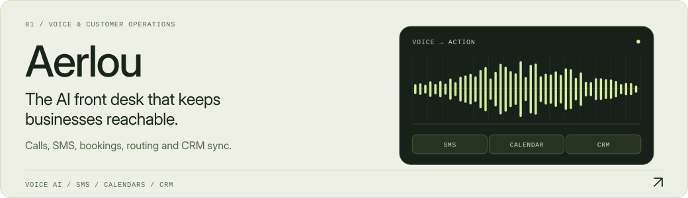
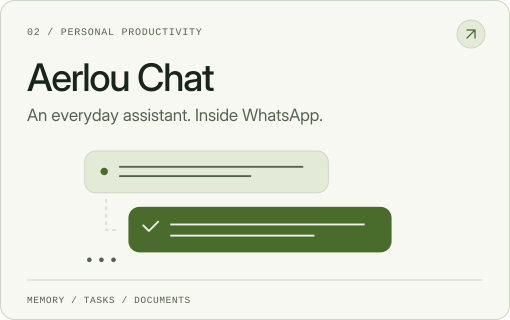
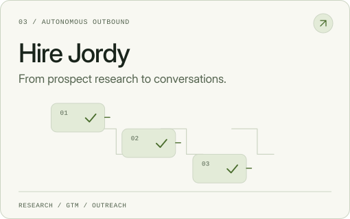
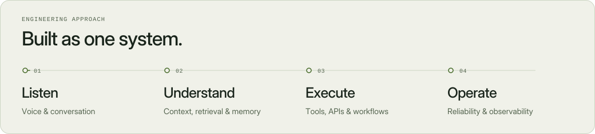
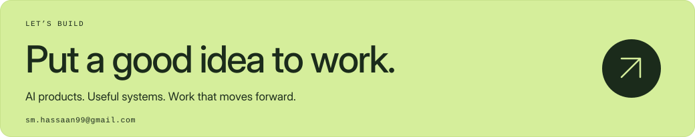

<p>
<picture>
  <source media="(prefers-reduced-motion: reduce) and (max-width: 600px) and (prefers-color-scheme: dark)" srcset="assets/hero-mobile-dark-still.svg">
  <source media="(prefers-reduced-motion: reduce) and (max-width: 600px)" srcset="assets/hero-mobile-light-still.svg">
  <source media="(prefers-reduced-motion: reduce) and (prefers-color-scheme: dark)" srcset="assets/hero-dark-still.svg">
  <source media="(prefers-reduced-motion: reduce)" srcset="assets/hero-light-still.svg">
  <source media="(max-width: 600px) and (prefers-color-scheme: dark)" srcset="assets/hero-mobile-dark.svg">
  <source media="(max-width: 600px)" srcset="assets/hero-mobile-light.svg">
  <source media="(prefers-color-scheme: dark)" srcset="assets/hero-dark.svg">
  
</picture>
</p>

<p align="center">
  <b>Syed Muhammad Hassaan Bin Ghayas</b><br>
  AI Engineer · Full-stack Product Builder · Ryzon Labs
</p>

<p align="center">
  <a href="https://ryzonlabs.com"><b>Ryzon Labs ↗</b></a> &nbsp; · &nbsp;
  <a href="https://www.linkedin.com/in/syed-muhammad-hassaan"><b>LinkedIn ↗</b></a> &nbsp; · &nbsp;
  <a href="mailto:sm.hassaan99@gmail.com"><b>Get in touch ↗</b></a>
</p>

I build AI-powered systems for real business workflows, connecting conversational interfaces, intelligent decision-making, operational tools and production infrastructure into complete products.

## Selected systems

<p>
<a href="https://aerlou.com">
<picture>
  <source media="(prefers-reduced-motion: reduce) and (max-width: 600px) and (prefers-color-scheme: dark)" srcset="assets/aerlou-mobile-dark-still.svg">
  <source media="(prefers-reduced-motion: reduce) and (max-width: 600px)" srcset="assets/aerlou-mobile-light-still.svg">
  <source media="(prefers-reduced-motion: reduce) and (prefers-color-scheme: dark)" srcset="assets/aerlou-dark-still.svg">
  <source media="(prefers-reduced-motion: reduce)" srcset="assets/aerlou-light-still.svg">
  <source media="(max-width: 600px) and (prefers-color-scheme: dark)" srcset="assets/aerlou-mobile-dark.svg">
  <source media="(max-width: 600px)" srcset="assets/aerlou-mobile-light.svg">
  <source media="(prefers-color-scheme: dark)" srcset="assets/aerlou-dark.svg">
  
</picture>
</a>
</p>

<p>
<a href="https://chat.aerlou.com">
<picture>
  <source media="(prefers-reduced-motion: reduce) and (max-width: 600px) and (prefers-color-scheme: dark)" srcset="assets/aerlou-chat-mobile-dark-still.svg">
  <source media="(prefers-reduced-motion: reduce) and (max-width: 600px)" srcset="assets/aerlou-chat-mobile-light-still.svg">
  <source media="(prefers-reduced-motion: reduce) and (prefers-color-scheme: dark)" srcset="assets/aerlou-chat-dark-still.svg">
  <source media="(prefers-reduced-motion: reduce)" srcset="assets/aerlou-chat-light-still.svg">
  <source media="(max-width: 600px) and (prefers-color-scheme: dark)" srcset="assets/aerlou-chat-mobile-dark.svg">
  <source media="(max-width: 600px)" srcset="assets/aerlou-chat-mobile-light.svg">
  <source media="(prefers-color-scheme: dark)" srcset="assets/aerlou-chat-dark.svg">
  
</picture>
</a>
<a href="https://hirejordy.com">
<picture>
  <source media="(prefers-reduced-motion: reduce) and (max-width: 600px) and (prefers-color-scheme: dark)" srcset="assets/hire-jordy-mobile-dark-still.svg">
  <source media="(prefers-reduced-motion: reduce) and (max-width: 600px)" srcset="assets/hire-jordy-mobile-light-still.svg">
  <source media="(prefers-reduced-motion: reduce) and (prefers-color-scheme: dark)" srcset="assets/hire-jordy-dark-still.svg">
  <source media="(prefers-reduced-motion: reduce)" srcset="assets/hire-jordy-light-still.svg">
  <source media="(max-width: 600px) and (prefers-color-scheme: dark)" srcset="assets/hire-jordy-mobile-dark.svg">
  <source media="(max-width: 600px)" srcset="assets/hire-jordy-mobile-light.svg">
  <source media="(prefers-color-scheme: dark)" srcset="assets/hire-jordy-dark.svg">
  
</picture>
</a>
</p>

<p>
<a href="https://zaofi.com">
<picture>
  <source media="(prefers-reduced-motion: reduce) and (max-width: 600px) and (prefers-color-scheme: dark)" srcset="assets/zaofi-mobile-dark-still.svg">
  <source media="(prefers-reduced-motion: reduce) and (max-width: 600px)" srcset="assets/zaofi-mobile-light-still.svg">
  <source media="(prefers-reduced-motion: reduce) and (prefers-color-scheme: dark)" srcset="assets/zaofi-dark-still.svg">
  <source media="(prefers-reduced-motion: reduce)" srcset="assets/zaofi-light-still.svg">
  <source media="(max-width: 600px) and (prefers-color-scheme: dark)" srcset="assets/zaofi-mobile-dark.svg">
  <source media="(max-width: 600px)" srcset="assets/zaofi-mobile-light.svg">
  <source media="(prefers-color-scheme: dark)" srcset="assets/zaofi-dark.svg">
  
</picture>
</a>
<a href="https://www.endifaa.com">
<picture>
  <source media="(prefers-reduced-motion: reduce) and (max-width: 600px) and (prefers-color-scheme: dark)" srcset="assets/endifaa-mobile-dark-still.svg">
  <source media="(prefers-reduced-motion: reduce) and (max-width: 600px)" srcset="assets/endifaa-mobile-light-still.svg">
  <source media="(prefers-reduced-motion: reduce) and (prefers-color-scheme: dark)" srcset="assets/endifaa-dark-still.svg">
  <source media="(prefers-reduced-motion: reduce)" srcset="assets/endifaa-light-still.svg">
  <source media="(max-width: 600px) and (prefers-color-scheme: dark)" srcset="assets/endifaa-mobile-dark.svg">
  <source media="(max-width: 600px)" srcset="assets/endifaa-mobile-light.svg">
  <source media="(prefers-color-scheme: dark)" srcset="assets/endifaa-dark.svg">
  
</picture>
</a>
</p>

<p>
<a href="https://myglobalhealth.online">
<picture>
  <source media="(prefers-reduced-motion: reduce) and (max-width: 600px) and (prefers-color-scheme: dark)" srcset="assets/global-health-mobile-dark-still.svg">
  <source media="(prefers-reduced-motion: reduce) and (max-width: 600px)" srcset="assets/global-health-mobile-light-still.svg">
  <source media="(prefers-reduced-motion: reduce) and (prefers-color-scheme: dark)" srcset="assets/global-health-dark-still.svg">
  <source media="(prefers-reduced-motion: reduce)" srcset="assets/global-health-light-still.svg">
  <source media="(max-width: 600px) and (prefers-color-scheme: dark)" srcset="assets/global-health-mobile-dark.svg">
  <source media="(max-width: 600px)" srcset="assets/global-health-mobile-light.svg">
  <source media="(prefers-color-scheme: dark)" srcset="assets/global-health-dark.svg">
  
</picture>
</a>
</p>

<details>
<summary><b>Inside the products — capabilities and context</b></summary>

### [Aerlou](https://aerlou.com)

Aerlou handles inbound calls and SMS around the clock. It understands why someone is calling, answers questions, books appointments on live calendars, routes conversations and synchronizes transcripts with business CRMs.

### [Aerlou Chat](https://chat.aerlou.com)

Aerlou Chat brings an intelligent assistant into WhatsApp. It remembers context, creates reminders, summarizes documents, manages tasks, tracks expenses and organizes everyday administrative work.

### [Hire Jordy](https://hirejordy.com)

Hire Jordy researches markets and prospects, develops go-to-market positioning, creates personalized campaigns, executes email and LinkedIn outreach and moves qualified conversations toward booked meetings.

### [ZaoFi](https://zaofi.com)

ZaoFi tracks whale activity, insider transactions and Congressional trades. It connects fragmented market signals into explainable conviction scores, helping investors understand what is happening and why it may matter.

### [Endifaa](https://www.endifaa.com)

Endifaa helps athletes and families discover, compare and connect with academies, programs and sporting opportunities across Saudi Arabia.

### [Global Health](https://myglobalhealth.online)

Global Health connects patients with consultations, specialists, prescriptions, memberships, payments and medical workflows through one localized platform designed for multi-country healthcare operations.

</details>

## How I build

<p>
<picture>
  <source media="(prefers-reduced-motion: reduce) and (max-width: 600px) and (prefers-color-scheme: dark)" srcset="assets/approach-mobile-dark-still.svg">
  <source media="(prefers-reduced-motion: reduce) and (max-width: 600px)" srcset="assets/approach-mobile-light-still.svg">
  <source media="(prefers-reduced-motion: reduce) and (prefers-color-scheme: dark)" srcset="assets/approach-dark-still.svg">
  <source media="(prefers-reduced-motion: reduce)" srcset="assets/approach-light-still.svg">
  <source media="(max-width: 600px) and (prefers-color-scheme: dark)" srcset="assets/approach-mobile-dark.svg">
  <source media="(max-width: 600px)" srcset="assets/approach-mobile-light.svg">
  <source media="(prefers-color-scheme: dark)" srcset="assets/approach-dark.svg">
  
</picture>
</p>

Start with the operational problem. Connect intelligence to context and tools. Design for real workflows, edge cases and fallbacks. Measure, learn and improve after deployment.

<details>
<summary><b>Toolchain</b> — engineering, intelligence and infrastructure</summary>

**Core engineering**  
`Python` · `TypeScript` · `JavaScript` · `React` · `Next.js` · `Django` · `Flutter`

**Intelligence & data**  
`PyTorch` · `TensorFlow` · `OpenCV` · `PostgreSQL` · `MySQL`

**Infrastructure**  
`Docker` · `AWS` · `Linux` · `Git` · `GitHub` · `Vercel`

</details>

<details>
<summary><b>Background & engineering principles</b></summary>

I'm a Computer Science graduate from **Swinburne University of Technology**, with a dual major in **Data Science** and **Artificial Intelligence**.

```yaml
product:
  start_with: the operational problem
  optimize_for: measurable business value

intelligence:
  connect_to: context, data and tools
  protect_with: boundaries, fallbacks and observability

engineering:
  design_for: real workflows and edge cases
  ship_when: the system can survive real usage

deployment:
  is_not: the finish line
  next_step: measure, learn and improve
```

</details>

<br>

<p>
<a href="mailto:sm.hassaan99@gmail.com">
<picture>
  <source media="(prefers-reduced-motion: reduce) and (max-width: 600px) and (prefers-color-scheme: dark)" srcset="assets/connect-mobile-dark-still.svg">
  <source media="(prefers-reduced-motion: reduce) and (max-width: 600px)" srcset="assets/connect-mobile-light-still.svg">
  <source media="(prefers-reduced-motion: reduce) and (prefers-color-scheme: dark)" srcset="assets/connect-dark-still.svg">
  <source media="(prefers-reduced-motion: reduce)" srcset="assets/connect-light-still.svg">
  <source media="(max-width: 600px) and (prefers-color-scheme: dark)" srcset="assets/connect-mobile-dark.svg">
  <source media="(max-width: 600px)" srcset="assets/connect-mobile-light.svg">
  <source media="(prefers-color-scheme: dark)" srcset="assets/connect-dark.svg">
  
</picture>
</a>
</p>

<p align="center">
  <a href="mailto:sm.hassaan99@gmail.com">Email</a> &nbsp; / &nbsp;
  <a href="https://ryzonlabs.com">Ryzon Labs</a> &nbsp; / &nbsp;
  <a href="https://www.linkedin.com/in/syed-muhammad-hassaan">LinkedIn</a> &nbsp; / &nbsp;
  <a href="https://github.com/Brxerq?tab=overview">GitHub activity</a>
</p>
