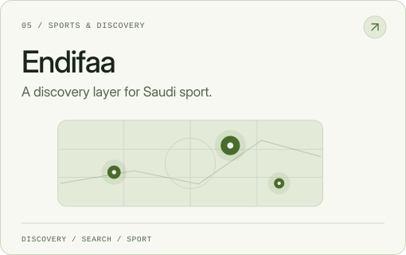
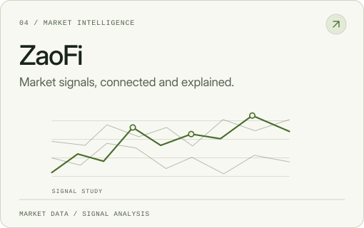

<a href="https://brxerq.github.io/app/">
<picture>
  <source media="(max-width: 600px) and (prefers-color-scheme: dark)" srcset="assets/hero-mobile-dark.svg">
  <source media="(max-width: 600px)" srcset="assets/hero-mobile-light.svg">
  <source media="(prefers-color-scheme: dark)" srcset="assets/hero-dark.svg">
  
</picture>
</a>

  <a href="https://brxerq.github.io/app/"><b>Portfolio ↗</b></a> &nbsp;·&nbsp;
  <a href="https://www.linkedin.com/in/syed-muhammad-hassaan/"><b>LinkedIn ↗</b></a> &nbsp;·&nbsp;
  <a href="https://ryzonlabs.com"><b>Ryzon Labs ↗</b></a> &nbsp;·&nbsp;
  <a href="https://ryzuntech.com/"><b>RyzunTech ↗</b></a> &nbsp;·&nbsp;
  <a href="mailto:sm.hassaan99@gmail.com"><b>Email ↗</b></a>

I design and build AI products, web platforms and automation for startups and businesses around the world: AI agents and chatbots, web apps and platforms, workflow automation, and websites built to rank.

<a href="https://brxerq.github.io/app/">
<picture>
  <source media="(max-width: 600px) and (prefers-color-scheme: dark)" srcset="assets/clients-mobile-dark.svg">
  <source media="(max-width: 600px)" srcset="assets/clients-mobile-light.svg">
  <source media="(prefers-color-scheme: dark)" srcset="assets/clients-dark.svg">
  
</picture>
</a>

## Selected projects

Five products I designed and built: four for clients and one of my own. All are live. Click a card to visit.

<a href="https://www.myglobalhealth.online/">
<picture>
  <source media="(max-width: 600px) and (prefers-color-scheme: dark)" srcset="assets/global-health-mobile-dark.svg">
  <source media="(max-width: 600px)" srcset="assets/global-health-mobile-light.svg">
  <source media="(prefers-color-scheme: dark)" srcset="assets/global-health-dark.svg">
  
</picture>
</a>

<a href="https://hirejordy.com/">
<picture>
  <source media="(max-width: 600px) and (prefers-color-scheme: dark)" srcset="assets/jordy-mobile-dark.svg">
  <source media="(max-width: 600px)" srcset="assets/jordy-mobile-light.svg">
  <source media="(prefers-color-scheme: dark)" srcset="assets/jordy-dark.svg">
  
</picture>
</a>

<a href="https://aertonic.com/">
<picture>
  <source media="(max-width: 600px) and (prefers-color-scheme: dark)" srcset="assets/aertonic-mobile-dark.svg">
  <source media="(max-width: 600px)" srcset="assets/aertonic-mobile-light.svg">
  <source media="(prefers-color-scheme: dark)" srcset="assets/aertonic-dark.svg">
  
</picture>
</a>

<a href="https://endifaa.com/">
<picture>
  <source media="(max-width: 600px) and (prefers-color-scheme: dark)" srcset="assets/endifaa-mobile-dark.svg">
  <source media="(max-width: 600px)" srcset="assets/endifaa-mobile-light.svg">
  <source media="(prefers-color-scheme: dark)" srcset="assets/endifaa-dark.svg">
  
</picture>
</a>

<a href="https://zaofi.com/">
<picture>
  <source media="(max-width: 600px) and (prefers-color-scheme: dark)" srcset="assets/zaofi-mobile-dark.svg">
  <source media="(max-width: 600px)" srcset="assets/zaofi-mobile-light.svg">
  <source media="(prefers-color-scheme: dark)" srcset="assets/zaofi-dark.svg">
  
</picture>
</a>

<b>Other work</b> · product sites, client sites and an AI CRM

 

| Project | What it is | Stack |
| --- | --- | --- |
| [Aerlou](https://aerlou.com/) | Product site for an AI receptionist that answers calls and texts, books appointments and syncs transcripts to the CRM | Voice AI · CRM |
| [aerlou for WhatsApp](https://chat.aerlou.com/) | Landing page and app surface for a WhatsApp assistant that files voice notes, receipts and reminders | LLMs · WhatsApp |
| [RyzunTech](https://ryzuntech.com/) | The Dubai software and AI studio where I work with a friend | Next.js · SEO |
| [Asia Pacific Dental](https://apdc.com.sg/) | In-person and virtual booking, service pages and local SEO for a Singapore dental group | Booking · Local SEO |
| [Zen Sea Yacht](https://www.zenseayacht.com.sg/) | Charter site built around fleet pages and an enquiry flow | Enquiry flow · SEO |
| [J Hair Salon](https://jhair.sg/) | Salon site with booking and service listings | Booking · SEO |
| [Surplus Alliance](https://surplusalliancehk.com/en) | Corporate site for a Hong Kong investment holding company | Corporate · Multilingual |
| Sales Navigator CRM | AI CRM on Google Play for Quest Marketing, used by 50+ people. It cut the team's manual work by 40% | Flutter · Python · OpenAI API |

<b>AI experiments</b> · live demos on Hugging Face

 

| | Experiment | Built with |
| --- | --- | --- |
| May 2024 | **Shelf monitoring.** Real-time out-of-stock and misalignment detection for supermarket shelves, trained on 1,000 annotated images. [Live demo](https://huggingface.co/spaces/brxerq/ShelvesDetection) · [Code](https://github.com/Brxerq/Super-Market_Shelves_Detection_Object-Detection) | TensorFlow · SSD MobileNet V2 |
| Dec 2023 | **Face attendance with anti-spoofing.** Accepts only a live person: blink analysis, a hand-gesture check, phone detection and skin-texture analysis. [Live demo](https://huggingface.co/spaces/brxerq/anti-spoofing) | OpenCV · Dlib · YOLOv4 · MediaPipe |
| Mar 2023 | **Bird species classification.** 200 species from CUB-200, from a baseline CNN to a fine-tuned MobileNetV3. [Live demo](https://huggingface.co/spaces/brxerq/Bird_Classification) | TensorFlow · MobileNetV3 |

<picture>
  <source media="(max-width: 600px) and (prefers-color-scheme: dark)" srcset="assets/experience-mobile-dark.svg">
  <source media="(max-width: 600px)" srcset="assets/experience-mobile-light.svg">
  <source media="(prefers-color-scheme: dark)" srcset="assets/experience-dark.svg">
  
</picture>

<b>Education & certifications</b>

 

**Swinburne University of Technology** · Bachelor of Computer Science, dual major in Data Science & AI · 2021 – 2024
**Swinburne University of Technology, Sarawak** · Foundation, Information Technology / Multimedia · 2020 – 2021

- **Getting Started with AI on Jetson Nano** · NVIDIA · Aug 2025
- **Building RAG Agents with LLMs** · NVIDIA · Aug 2025
- **Fundamentals of Digital Marketing** · Google Digital Garage · Jul 2022
- **Cisco Certified Network Associate (CCNA)** · Cisco · Nov 2021

## Activity

<picture>
  <source media="(prefers-color-scheme: dark)" srcset="https://raw.githubusercontent.com/Brxerq/Brxerq/output/activity-dark.svg">
  
</picture>

<picture>
  <source media="(max-width: 600px) and (prefers-color-scheme: dark)" srcset="assets/stack-mobile-dark.svg">
  <source media="(max-width: 600px)" srcset="assets/stack-mobile-light.svg">
  <source media="(prefers-color-scheme: dark)" srcset="assets/stack-dark.svg">
  
</picture>

<a href="mailto:sm.hassaan99@gmail.com">
<picture>
  <source media="(max-width: 600px) and (prefers-color-scheme: dark)" srcset="assets/contact-mobile-dark.svg">
  <source media="(max-width: 600px)" srcset="assets/contact-mobile-light.svg">
  <source media="(prefers-color-scheme: dark)" srcset="assets/contact-dark.svg">
  
</picture>
</a>

  <a href="mailto:sm.hassaan99@gmail.com">Email</a> &nbsp;/&nbsp;
  <a href="https://www.linkedin.com/in/syed-muhammad-hassaan/">LinkedIn</a> &nbsp;/&nbsp;
  <a href="https://www.instagram.com/ha_ssaann/">Instagram</a> &nbsp;/&nbsp;
  <a href="https://brxerq.github.io/app/">Portfolio</a>

